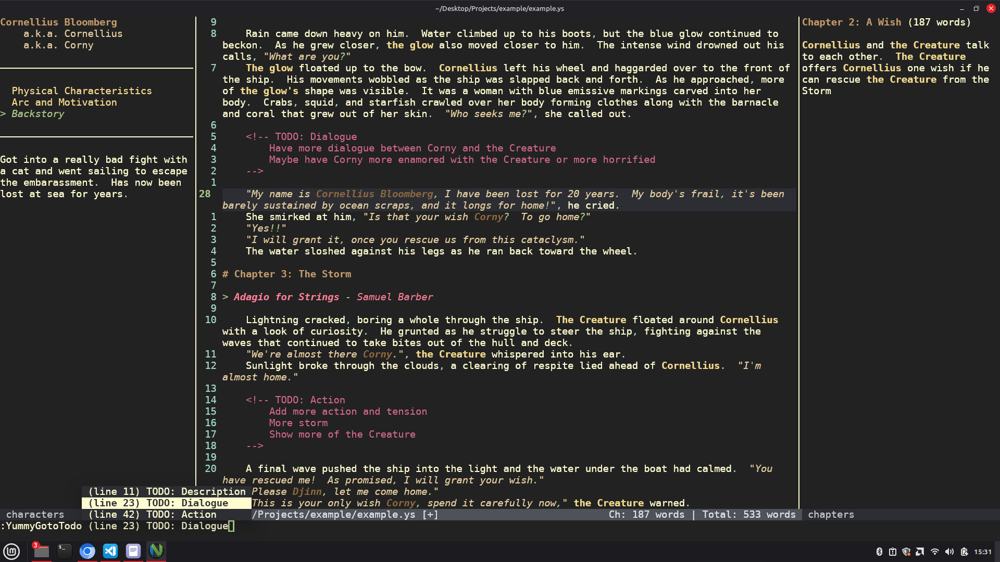

# Yummy

Yummy is a neovim plugin used for writing inspired by Lekha.  Yummy is a little more feature heavy.  Yummy provides support for live viewing character and chapter information while writing; coloring of different writing elements like character names, dialogue, separators, etc.; and movement commands to streamline moving around your manuscript.

## Yummy Custom Windows

When viewing a yummy file, the screen will be split between 3 windows: character information on the left, outline information on the right, and the file buffer in the middle.  The file buffer by default takes up 60% of the screen's width (this is configurable).  When your cursor hovers over a character's name, that character's name, their aliases, and extra information from that character's definition in a .yc file are displayed in the left side characters window.  When your cursor hovers inside of a chapter, chapter information from that chapter's definition in a .yo file including word count is displayed in the right side outline window.

## Yummy Project

A Yummy project consists of four types of files:
- .ys : The actual content of the project you're writing such as manuscripts
- .yc : List of Characters, their aliases, and extra information
- .yo : Outline of Chapters or Segments, each can be given a description and extra information
- .yummy : marker file to represent the root of the project

The .yummy file is an empty file.  Place at the root of your project, Yummy will not work without a .yummy file.

Multiple .ys, .yc, and .yo files can exist in a Yummy Project, even inside nested directories, allowing for easy organization.  For example, a main_characters.yc, side_characters.yc, gods.yc, and references.yc (when a character mentions a famous person or a character from another piece of media) for character files and then outline.yo, entries.yo, dialogue.yo, etc.

## Writing a Yummy File

.ys, .yc, and .yo files are written like markdown.  For a .yo file, chapters are defined with a `#` and information can be stored directly under the definition.  A .yc file, you can define characters with `#` and aliases for that character are defined in a list immediately after the character definition; character tabs can be defined with `##`, tabs can be anything a writer wants (I like `Physical Characteristics`, `Arc and Motivation`, `Backstory`).  Only one tab is shown at a time and the tab can be chained easily.  .ys files are the meat, the big potatoes, where your actual manuscript lives almost forever.  See the example folder to see what a Yummy project looks like.

## QoL for Writers

### Comments and Todo

Comments can be written like `<!-- comment -->`.  Comments do not count towards word count

Todos are written like `<!-- TODO: Multi-word Label \n Description goes here -->`.  Using commands, the user can jump to various Todos.

### Commands

Commands
- `:YummyGotoPrevChapterStart`
- `:YummyGotoNextChapterStart`
- `:YummyGotoPrevChapterEnd`
- `:YummyGotoNextChapterEnd`
- `:YummyGotoChapter`
- `:YummyGotoPrevTodo`
- `:YummyGotoNextTodo`
- `:YummyGotoTodo`
- `:YummyPrevTab`
- `:YummyNextTab`

`:YummyGotoChapter` and `:YummyGotoTodo` have tab autocomplete support

`:YummyPrevTab` and `:YummyNextTab` will swap the shown Character Tab.

### Chapter and Total Word Count

The word count of the current chapter (and the manuscript's total words) is displayed at the bottom status line.  The word count of the current chapter is also displayed in the outline panel.  Comments, Todos, Separators `* * *`, Block Quotes `> text`, Song Definitions `> song name - song artist`, and Chapter Definitions `# Chapter L` do not count towards any word count.

### Writing Text

En dashes (–) and Em dashes (—) can be made by typing `\-- ` and `\--- ` (the space is important).  Also separators `* * *` can be added and they automatically sit in the center (This does not change the underlying text of the buffer, just purely visual).  Using a block quote, you can define a song or piece of media or something with the format `> song name - song artist`.

### Highlighting

Different Writing Elements can be colored uniquely.  There is a yummy-dark color scheme that can sit on top of any other color scheme without modifying the base scheme.  There is also a yummy-cookies-and-cream color scheme that is a full scheme including the Yummy Elements.

Yummy Elements
- YummyQuote             : Text within quotes (e.g. "You're gonna want to take a look at this!").  Useful for dialogue.
- YummyName              : Character Names or Aliases, includes elongations (e.g. Steven to Ssssteeeevvvvennnn) and possessives (e.g. Steven's).  Is Case Sensitive.
- YummyNameQuoted        : Character Names or Aliases found in quotes (e.g. "I was talking to Sarah earlier.")
- YummyChapter           : Chapter Declarations
- YummyCharacterHeader   : Character Declarations
- YummyCharacterAlias    : Character Alias Declarations
- YummyTabHeader         : Character Tab Declarations
- YummyBlockquote        : Block Quotes
- YummySongName          : The Song Name within a Song Definition
- YummySongArtist        : The Song Artist within a Song Definition
- YummyTodo              : Todos
- YummyComment           : Comments
- YummySeparator         : Separator
- YummyPunctuation       : Punctuation including en and em dashes
- YummyPunctuationQuoted : Punctuation found inside quotes

## How to Use

Download like normal using git clone in your `.config/nvim/namespace/start/` directory

In your init.lua file, add `require("yummy").setup()` or `require("yummy").setup({center_width = 0.50})` if you want to modify the width of the center window (the value should be between 0.0 and 1.0, default is 0.60)

## Other Plugins

If this is too many features for you and you just want something a little more lightweight, [Lekha](https://github.com/kghose/lekha.nvim) is great and heavily inspired this project.

## TODO

- [] Better Buffer Formatting for Easier navigation??
- [] Support for Curly Quotes and Apostrophes??
- [] Add locations with a .yl file and corresponding color mappings
- [] Maybe add tabs to .yo files??
- [] Shrink or hide comments and shrink todos